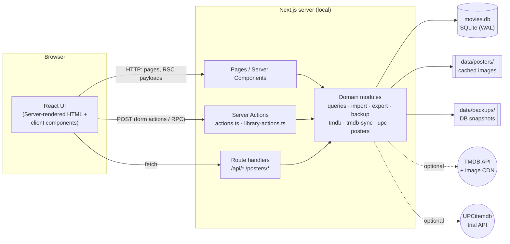
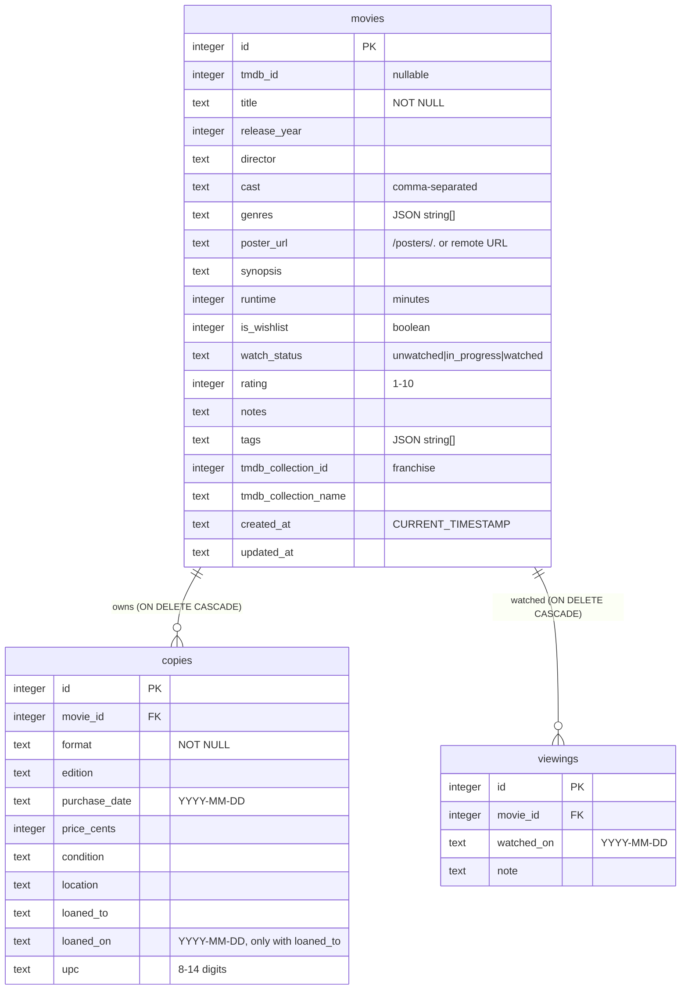
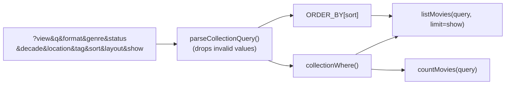
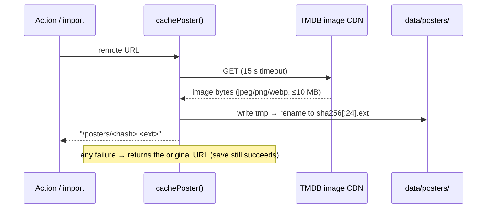
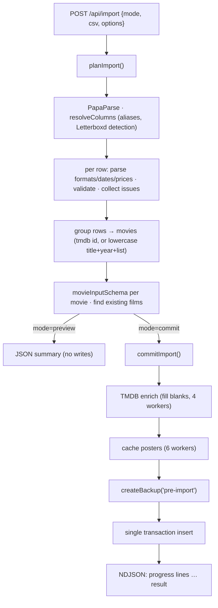

# Movie Vault — Architecture

This document describes how Movie Vault is built: its structure, data model, request flows, external integrations, and the conventions and pitfalls that matter when changing it.

The user-facing behaviour is documented in [USER_MANUAL.md](USER_MANUAL.md). The original product spec is `FUNCTIONAL-REQ.mc` (Markdown, despite the extension). `CLAUDE.md` keeps a condensed version of the conventions here for AI-assisted development.

---

## Contents

1. [Goals and constraints](#1-goals-and-constraints)
2. [Technology stack](#2-technology-stack)
3. [System context](#3-system-context)
4. [Repository layout](#4-repository-layout)
5. [Rendering model](#5-rendering-model)
6. [Routes](#6-routes)
7. [Data model](#7-data-model)
8. [Server layer: reads, writes, validation](#8-server-layer-reads-writes-validation)
9. [The collection query](#9-the-collection-query)
10. [External integrations](#10-external-integrations)
11. [Import and export](#11-import-and-export)
12. [Backups](#12-backups)
13. [Client architecture](#13-client-architecture)
14. [Theming and styling](#14-theming-and-styling)
15. [Security and privacy](#15-security-and-privacy)
16. [Testing](#16-testing)
17. [Configuration](#17-configuration)
18. [Conventions and pitfalls](#18-conventions-and-pitfalls)
19. [Extending the app](#19-extending-the-app)
20. [Design decisions](#20-design-decisions)
21. [Known limitations](#21-known-limitations)

---

## 1. Goals and constraints

- **Local-first, single user.** One person runs it on their own machine. There are no accounts and no hosted backend. The whole collection is one SQLite file.
- **Works offline.** Everything except TMDB and barcode lookups works without a network, including posters, which are cached locally.
- **Data portability.** CSV and JSON export, and a CSV import that understands other apps' exports. CSV export → import → export must be byte-identical.
- **Low operational burden.** Migrations apply themselves, backups are automatic, and there's nothing to deploy.
- **Modern Next.js.** Next.js 16 App Router with Cache Components (partial prerendering): static shells, with request-time data streamed in through `<Suspense>`.

---

## 2. Technology stack

| Concern | Choice | Notes |
|---|---|---|
| Framework | **Next.js 16.4** (App Router, Turbopack) | `cacheComponents` and `partialPrefetching` enabled in `next.config.ts` |
| UI runtime | **React 19.3** | Server Components by default; React Compiler lint rules |
| Language | TypeScript 5 (strict) | Path alias `@/*` → `src/*` |
| Database | **SQLite** via **better-sqlite3** 13 | Synchronous driver, WAL mode, foreign keys on |
| ORM / migrations | **Drizzle ORM** 0.45 + drizzle-kit 0.31 | SQL migrations in `drizzle/`, applied automatically at startup |
| Validation | **Zod** 4 | One schema shared by the form, server actions and CSV import |
| CSV | PapaParse 5 | Parse on import, unparse on export |
| Styling | **Tailwind CSS v4** | No config file; tokens in `src/app/globals.css` |
| Components | **shadcn/ui (base-nova)** on **Base UI** | Not Radix: uses the `render` prop, not `asChild` |
| Icons / toasts / theme | lucide-react, sonner, next-themes | |
| Unit tests | **Vitest** 4.1 | Node environment, real temp SQLite DB |
| E2E tests | **Playwright** 1.64 | Runs on the locally installed Microsoft Edge |
| External APIs | TMDB v3 API, UPCitemdb (trial) | Both optional |

---

## 3. System context



All external calls are made **from the server**. The browser never sees the TMDB credentials, and it never contacts TMDB or UPCitemdb directly. The one exception is the remote poster thumbnails shown in TMDB search results and on franchise pages, which load straight from TMDB's image CDN.

---

## 4. Repository layout

```
├─ drizzle/                    SQL migrations (generated, committed) + meta snapshots
├─ docs/                       This document and the user manual
├─ e2e/                        Playwright specs + helpers
├─ scripts/vitest.mjs          Vitest launcher (Windows drive-letter fix)
├─ test/                       Vitest setup (temp DB/dirs) + server-only stub
├─ src/
│  ├─ app/                     App Router: pages, layouts, route handlers
│  │  ├─ page.tsx              Collection (home)
│  │  ├─ movies/add|[id]|[id]/edit
│  │  ├─ franchises/ , franchises/[id]
│  │  ├─ data/                 Import & export, TMDB refresh, backups
│  │  ├─ posters/[file]/       Serves cached posters
│  │  └─ api/                  export · import · random · upc · tmdb/{search,movie/[id],refresh}
│  ├─ components/              App components (client + server)
│  │  └─ ui/                   shadcn/ui primitives (generated, owned by the repo)
│  ├─ db/                      schema.ts (tables, relations, types) · index.ts (connection + migrate)
│  └─ lib/                     Domain logic (most of it server-only) + unit tests (*.test.ts)
├─ movies.db                   The database (gitignored)
├─ data/                       posters/ and backups/ (gitignored)
├─ next.config.ts · drizzle.config.ts · vitest.config.mts · playwright.config.ts
└─ CLAUDE.md · AGENTS.md · FUNCTIONAL-REQ.mc
```

### `src/lib` modules

| Module | Responsibility | Runs on |
|---|---|---|
| `queries.ts` | All reads: collection list/count, filter options, stats, top rated, franchises, viewings, duplicate and UPC lookups | server-only |
| `actions.ts` | Server Actions for the movie form: create, update, delete, mark purchased, back up now. These redirect. | server |
| `library-actions.ts` | Server Actions that return `{ok, message}`: viewings, bulk edit, TMDB refresh, add franchise film to wishlist | server |
| `validation.ts` | Zod schemas (`movieInputSchema`, `copySchema`) and form value types | shared |
| `collection-params.ts` | URL search params ⇄ `CollectionQuery`, sorts, special filter values, page size | shared |
| `constants.ts` | Formats, statuses, conditions, edition suggestions, shared ids | shared |
| `csv-format.ts` | CSV column layout, header aliases, cell parsers, formula escaping | shared (pure) |
| `import.ts` | CSV → plan (validate, group, dedupe) → commit (enrich, cache posters, insert) | server-only |
| `export.ts` | CSV and JSON export | server-only |
| `tmdb.ts` | TMDB client: search, movie details (+credits, franchise), collections | server-only |
| `tmdb-sync.ts` | Refresh one movie from TMDB (`overwrite` or `fill`) | server-only |
| `upc.ts` / `upc-title.ts` | UPCitemdb lookup / product-title cleaning and format guessing (pure) | server-only / shared |
| `posters.ts` / `poster-cleanup.ts` | Download and cache posters; delete unreferenced files | server-only |
| `backup.ts` | Online SQLite backups, retention | server-only |
| `format.ts`, `params.ts`, `utils.ts` | Display formatting, route param parsing, `cn` | shared |

---

## 5. Rendering model

`cacheComponents: true` turns on **partial prerendering**:

- At build time, each page's **static shell** (layout, header, headings, skeletons) is prerendered.
- Anything that reads request data (`params`, `searchParams`, `connection()`) or the database must live **inside `<Suspense>`**. At request time it streams into the shell. An uncached dynamic read outside `<Suspense>` is a build error ("blocking route").
- Nothing uses `"use cache"`: every DB read is per request, because the data changes whenever the user edits something.

The standard page shape:

```tsx
export default function Page({ searchParams }: PageProps<"/">) {
  return (
    <>
      <h1>…static…</h1>
      <Suspense fallback={<Skeleton />}>
        <Data searchParams={searchParams} />   {/* awaits params + reads DB */}
      </Suspense>
    </>
  );
}
```

**Components that read the DB but no request data** (stats tiles, top-rated carousel, backups panel, franchise list, tag suggestions) call `await connection()` first. Without it, Next would prerender them with build-time data.

**Clock reads.** `new Date()` / `Date.now()` must not run at module scope or during render, because the time would freeze into the prerender. Client components read the clock in event handlers (date pickers, "today" defaults). Server components only after `connection()`.

**Build-time decisions.** `/movies/add` and `/data` are fully static. Whether TMDB is configured (`isTmdbConfigured()`) is therefore decided **at build time** for those pages, so rebuild after changing `.env.local`.

**Mutations and freshness.** Server actions call `revalidatePath("/", "layout")` (and sometimes a specific path) after writing. The client router then refetches the affected RSC payloads.

**Route activity.** Next keeps recently visited routes mounted but hidden, so their client state survives back/forward navigation. Two pages' DOM can therefore coexist; see [section 18](#18-conventions-and-pitfalls) for the consequence for element ids.

---

## 6. Routes

### Pages

| Route | Rendering | Purpose |
|---|---|---|
| `/` | Static shell + streamed stats, carousel and collection | Collection: tabs, search, filters, grid/list, bulk select, pagination |
| `/movies/add` | Static (+ streamed tag suggestions) | Add form: TMDB search, barcode lookup |
| `/movies/[id]` | Streamed | Movie detail, copies, watch history, actions |
| `/movies/[id]/edit` | Streamed | Edit form |
| `/franchises` | Streamed | Franchises the vault touches |
| `/franchises/[id]` | Streamed (TMDB fetch at request time) | Franchise parts: owned, wishlist, missing |
| `/data` | Static (+ streamed backups list) | Export, import wizard, TMDB refresh, backups |

### Route handlers

| Method + path | Purpose | Response |
|---|---|---|
| `GET /api/tmdb/search?q=&year=` | Proxy TMDB search | JSON `{results}` |
| `GET /api/tmdb/movie/[id]` | TMDB details (credits, franchise) | JSON `TmdbMovieDetails` |
| `POST /api/tmdb/refresh` | Fill blanks from TMDB for every movie | **NDJSON stream** of progress lines, then a result |
| `GET /api/upc?code=` | Barcode lookup + local duplicate check | JSON `UpcLookupResponse` |
| `GET /api/random?…collection params` | Random pick for "Surprise me" | JSON `{pick}` |
| `GET /api/export?format=csv\|json` | Download the whole collection | file attachment |
| `POST /api/import` | `mode: "preview"` → JSON summary; `mode: "commit"` → NDJSON stream | |
| `GET /posters/[file]` | Serve cached poster files | image, immutable cache |

### Server Actions

| Action | Called from | Behaviour |
|---|---|---|
| `createMovie`, `updateMovie` | Movie form (`useActionState`) | Validate, duplicate check, cache poster, back up if due, transaction, revalidate, **redirect** |
| `deleteMovie` | Delete button | Back up if due, delete (cascades), clean up the poster, redirect |
| `markPurchased` | Mark-as-purchased dialog | Wishlist → owned with the submitted copy (duplicate check) |
| `backupNow` | Backups panel | Manual snapshot |
| `logViewing`, `deleteViewing` | Watch history | Insert/delete a viewing; logging sets `watch_status=watched` |
| `bulkUpdate(ids, op)` | Select mode | `status` / `addTag` / `removeTag` / `delete` |
| `refreshMovieFromTmdb` | Movie page | `syncMovieFromTmdb(…, "overwrite")` |
| `addToWishlistFromTmdb` | Franchise page | Insert a wishlist movie from TMDB details |

---

## 7. Data model



**Indexes:** `movies(title)`, `movies(is_wishlist)`, `movies(tmdb_collection_id)`, `copies(movie_id)`, `copies(upc)`, `viewings(movie_id)`, `viewings(watched_on)`.

### Why the schema differs from the spec

The spec had a single `movies` table with one `format`. Real collections have the same film on several formats, each with its own edition, price, condition, shelf and loan, so ownership is split into **`copies`**. Other changes from the spec:

- `watch_status` is a 3-value enum rather than a boolean.
- `genres` and `tags` are JSON arrays, queried with `json_each`.
- Money is stored as integer cents.
- Dates are ISO strings.

### Semantics

- An **owned** movie has ≥1 copy (enforced by validation). For a **wishlist** movie, copies are "wanted formats" and are optional.
- Location and loans are **per copy**. `loaned_on` is cleared whenever `loaned_to` is empty (Zod transform).
- Tags are compared case-insensitively everywhere (filter, dedupe, bulk add/remove). The original spelling is kept.

### Migrations

- Edit `src/db/schema.ts`, run `npm run db:generate`, and commit the new `drizzle/NNNN_*.sql` and `drizzle/meta/*`.
- `src/db/index.ts` runs `migrate()` on the **first connection** in a process. So users never run migrations by hand, and a fresh checkout or a deleted DB just works.
- **Concurrency:** `next build` spawns workers that all open the DB and can race to apply the same pending migration. The losers fail (e.g. "duplicate column"). `createDb()` catches that, and retries `migrate()` once; by then the winner has committed, so the retry is a no-op. A genuinely broken migration fails again and is thrown.
- The connection is cached on `globalThis` across dev HMR, so a **running dev server won't apply a new migration until restarted**.
- History so far:
  - `0000` init.
  - `0001` location/loans.
  - `0002` tags, franchise, `upc`, `viewings`.

  All migrations after the first are additive.

---

## 8. Server layer: reads, writes, validation

### Reads (`queries.ts`)

All reads go through Drizzle. better-sqlite3 is synchronous, so the `async` functions run synchronously underneath; the async signatures keep call sites uniform. Collection reads use the **relational query API** (`db.query.movies.findMany({ with: { copies } })`), which returns `MovieWithCopies`.

### The form payload pattern

`MovieForm` is fully controlled. On submit it posts its entire state as **JSON in a hidden `payload` field**. The action parses that JSON with `movieInputSchema`, which:

- converts form strings to typed values (`""` → `null`, `"$19.99"` → `1999` cents, comma lists → arrays);
- validates ranges and formats;
- returns errors keyed by Zod path (`copies.0.format`), which the form maps back onto fields.

The **same schema** validates CSV import rows, so the form and import can't drift apart.

### Two action styles

- `actions.ts` actions are form actions used with `useActionState`. They return `MovieFormState` on error and **redirect** on success.
- `library-actions.ts` actions are RPC-style calls from client handlers inside `useTransition`. They return `ActionResult = {ok, message}` and never redirect, and the caller shows a toast.

Both call `backupIfDue()` before writing and `revalidatePath` after.

### Duplicate detection

A *duplicate* is the same film (title equal ignoring case, **or** same `tmdb_id`) that already has one of the formats being saved. The action returns `{status: "duplicate", duplicates}` unless the request carries `confirmDuplicate=1` (the "Save anyway" button). On edit, only newly added formats are checked unless the title or TMDB id changed, so a duplicate you've already confirmed doesn't warn again on every save.

### Writes and transactions

- **Create:** insert the movie, then insert its copies, in one transaction.
- **Update:** update the movie and **replace its copies wholesale** in one transaction. Copies have no identity outside their movie.
- **Delete:** cascades to copies and viewings.
- **Posters:** after an update or delete, the old poster file is removed if nothing references it any more (`deletePosterIfUnused`).

---

## 9. The collection query

The collection page's state lives **entirely in the URL**, so views are shareable and bookmarkable, and back/forward work.



| Param | Values | SQL |
|---|---|---|
| `view` | `owned` (default) / `wishlist` | `is_wishlist = ?` |
| `q` | text | `LIKE` on title, director, cast, tags (wildcards escaped) |
| `format` | a format, `digital`, or `@upgrade` | `EXISTS` copy with format / `LIKE 'Digital%'` / has DVD/VHS **and not** anything else |
| `genre`, `tag` | text | `EXISTS (SELECT 1 FROM json_each(col) WHERE value = ? COLLATE NOCASE)` |
| `status` | watch status | equality |
| `decade` | e.g. `1990` | `release_year BETWEEN 1990 AND 1999` |
| `location` | text or `@loaned` | `EXISTS` copy with location (NOCASE) / with `loaned_to IS NOT NULL` |
| `sort` | `title`, `year`, `added`, `rating`, `watched` | see `ORDER_BY` (nulls last) |
| `layout` | `grid` / `list` | client only |
| `show` | multiple of 60 | `LIMIT`; "Show more" adds 60. The filter bar drops it on any change. |

`getFilterOptions(view)` returns only values present in the data: genres, decades, formats, locations, tags (case-folded), plus `anyLoaned` and `anyUpgrade`, so the dropdowns never offer empty choices. `GET /api/random` reuses `listMovies` with the same parsed params, forcing `view=owned` and `status ?? "unwatched"`.

---

## 10. External integrations

### TMDB (`tmdb.ts`)

- **Auth:** the v4 read token goes in an `Authorization: Bearer` header (preferred, keeps secrets out of URLs). The v3 key falls back to an `api_key` query parameter.
- **Endpoints:**
  - `/search/movie`.
  - `/movie/{id}?append_to_response=credits`: director(s), the top 8 cast, genres, runtime, poster and `belongs_to_collection`.
  - `/collection/{id}`: a franchise's parts, sorted by release year.
- **Errors:** errors are typed `TmdbError` with an HTTP-ish status, and requests time out after 8 s.
  - **401** → "credentials rejected".
  - **404** → "not found".
  - **Network failure** → 502.
- **Matching without an id** (import enrichment, refresh): normalised title equality (accents, leading articles and punctuation removed), with the year within ±1. It searches with the year first, then without.

### TMDB sync (`tmdb-sync.ts`)

`syncMovieFromTmdb(movie, mode)` returns `"updated" | "unchanged" | "unmatched"`.

- **`overwrite`** (movie page button): replaces title, year, director, cast, genres, synopsis, runtime, poster and franchise.
- **`fill`** (bulk refresh): fills only `null` fields, adds a missing poster, and retries caching a poster that's still a remote URL. It always records the franchise.
- Personal fields and copies are never touched. It writes only if something changed, and cleans up a replaced poster file.

`POST /api/tmdb/refresh` runs `fill` across all movies with **4 concurrent workers**, streaming progress as NDJSON. If TMDB itself fails (bad credentials, unreachable), it stops early instead of failing every movie.

### Poster cache (`posters.ts`)



- Files are **content-addressed**, so the same image is stored once and is safe to serve with `Cache-Control: immutable`.
- Writes are atomic (temp file + rename).
- They're served by `src/app/posters/[file]/route.ts`, **not `public/`**, because Next only serves `public/` files that existed at build time. The handler only accepts names matching `^[a-z0-9_-]+\.(jpg|png|webp)$`, which prevents path traversal.
- Posters render with a plain ``, not `next/image`. They're already sized and served locally.

### Barcodes (`upc.ts`, `upc-title.ts`)

- `GET https://api.upcitemdb.com/prod/trial/lookup?upc=…`: a free trial endpoint with no key, about 100 requests a day per IP. Only the digits are sent, with a generic `User-Agent`.
  - **429** → a friendly "daily limit" error.
  - **`INVALID_UPC`** or no items → `product: null`.
- `cleanUpcTitle()` cleans the retail product title:
  - It strips known home-video label prefixes ("Mill Creek - ") from a fixed list only, so "Star Wars - A New Hope" survives.
  - It strips bracketed groups made only of packaging words ("[BLU-RAY]", "(2-Disc Special Edition)").
  - It strips trailing runs of packaging words ("4K Ultra HD + Blu-ray"). Hyphenated words stay whole.
- `guessUpcFormat()` picks the best format mentioned, in the order 4K UHD > Blu-ray > DVD > VHS.
- The route also returns local copies with the same `upc` so the UI can warn about duplicates, **even when the online lookup fails**.
- **Camera scanning** (`BarcodeLookup` → `CameraScanner`) uses the browser's `BarcodeDetector` (EAN-13/UPC-A/EAN-8/UPC-E) with `getUserMedia`. It's only offered when the API exists **and** the page is a secure context. `localhost` counts; plain-HTTP LAN addresses don't.

---

## 11. Import and export

### CSV layout (`CSV_COLUMNS`)

```
title, release_year, director, cast, genres, runtime, synopsis, tmdb_id, poster_url,
list, watch_status, rating, notes, tags,                                  ← movie-level
format, edition, purchase_date, price, condition, location, loaned_to,
loaned_on, upc,                                                           ← copy-level
date_added
```

- **One row per copy.** Movie-level columns repeat on each row. A movie with no copies is one row with empty copy columns.
- Lists (`genres`, `tags`) are joined with `"; "`. `list` is `owned`/`wishlist`. `price` is `"19.99"`.
- **Invariant:** export → import → export must be **byte-identical**. Any layout change must keep this; it's enforced by `src/lib/round-trip.test.ts` and an e2e test.
- **Export details:** UTF-8 **BOM** (so Excel detects the encoding), **CRLF** line endings, and **formula-injection guard**: cells starting with `= + - @ \t \r` get a leading `'`. `unescapeCell` removes it on import.
- **JSON export:** every movie with its copies **and viewings** (`{app, version: 1, exportedAt, movies}`). It's not importable yet; it serves as a complete backup.

### Import pipeline (`import.ts`)



- **Stateless:** commit re-parses the CSV rather than trusting a cached preview.
- **Limits:** 5 MB and 5,000 rows.
- **Header aliases** cover common spreadsheet, Letterboxd and CLZ names (e.g. *Name, Year, Media Type, Purchase Price, Shelf, Lent To, UPC*). A `Letterboxd URI` column means ratings are doubled and rows are marked watched.
- **Formats:** an explicit combo separator (`+ , ; | & / and`) is split **before** whole-cell matching, because "4K Blu-ray" is the single 4K format. A combo's price is recorded once; its location and loan apply to every copy from the row.
- **Bad rows** are skipped individually and reported with their row numbers. "Skip existing" matches by TMDB id or title + year.

---

## 12. Backups

`backup.ts` uses SQLite's **online backup API** (`db.$client.backup(path)`), which gives a consistent snapshot while the app runs in WAL mode.

- **`backupIfDue()`** is called at the start of every mutating action. It snapshots only if the newest backup is older than `BACKUP_INTERVAL_HOURS` (24) and the DB has data. Taking the backup *before* the write makes it the last known-good state. It never throws: a failed backup is logged and the save proceeds.
- **`createBackup(reason)`** always snapshots. It's used for `pre-import` and `manual`. Concurrent callers share the in-flight backup.
- **Naming and retention:** files are named `movies-YYYY-MM-DDTHH-MM-SS[-reason].db`, and only the newest `BACKUP_KEEP` (14) are kept.
- **Restore** is manual: stop the app, copy the file over `movies.db`, and delete the `-wal`/`-shm` files. The steps are shown in the UI.

---

## 13. Client architecture

Server Components render most of the UI. Client components (`"use client"`) are used only where there's interaction:

| Component | Notes |
|---|---|
| `MovieForm` | Controlled form, JSON payload, `useActionState`. Ids are generated per instance with `useId()` (see [section 18](#18-conventions-and-pitfalls)). TMDB search and barcode lookup feed it via callbacks. |
| `TmdbSearch` | Debounced (350 ms) search with `AbortController`. Derives state during render instead of syncing state in effects (React Compiler lint). It re-mounts via `key` when a barcode lookup supplies a query. |
| `BarcodeLookup` | Not a `<form>`, because it lives inside the movie form; Enter is handled manually. `useSyncExternalStore` decides whether camera scanning is possible without a hydration mismatch. |
| `DatePicker` | A Base UI Popover with Month/Year selects. Changing them moves the selected date, clamping the day (Feb 29 → Feb 28). "Today" is read when the picker opens. |
| `FilterBar`, `SearchInput` | Update the URL with `router.replace` inside `useTransition`. Search is debounced (200 ms). |
| `CollectionResults` | Grid or list, plus **Select** mode (bulk edit toolbar). In grid mode each card is made `inert` and covered by a toggle button; the list gets a checkbox column. |
| `TopRatedCarousel` | An endless marquee: the cards are rendered twice, and a `requestAnimationFrame` loop moves a sub-pixel `translate3d` and wraps by one set's width. The animation state lives in refs, so it never re-renders per frame. It pauses on mouse hover, keyboard focus (`:focus-visible` only), and background tabs. It respects `prefers-reduced-motion` via `useSyncExternalStore`. The viewport is `overflow: clip`, so focus can't scroll it. The duplicate cards are `aria-hidden` + `inert`. |
| `WatchHistory`, `MarkPurchasedDialog`, `RefreshTmdbButton`, `RefreshAllPanel`, `AddToWishlistButton`, `SurpriseMeButton`, `BackupNowButton` | Thin wrappers that call a server action or route and show a toast |
| `ThemeToggle` | A `role="switch"`. The visuals come from `dark:` classes (correct on first paint); JS state is only used for `aria-checked`. |

### Shared UI primitives

`src/components/ui/*` are shadcn **base-nova** components built on **Base UI**. Some Base UI specifics:

- **Composition** uses `render={<Button/>}`, not Radix's `asChild`.
- **`Select`** shows the raw value unless given an `items` map; pass `null` as the value to show the placeholder.
- **`AlertDialogAction`** is a plain button: it doesn't close the dialog, so close a controlled dialog explicitly.

The primitives are generated, but owned by the repo and safe to edit.

---

## 14. Theming and styling

- **Tailwind v4, no config file.** `globals.css` declares tokens on `:root` (light) and `.dark`. `@theme inline` maps them to utilities (`bg-primary`, `text-muted-foreground`, …). The dark variant is `&:is(.dark *)`.
- **Palette:** neutrals carry a faint violet tint (hue ~295); the primary is violet. Further tokens:
  - `--glow`: the page's radial backdrop.
  - `--gradient-from/to`: the `text-gradient` utility used for headings.
  - `--chart-bar/--chart-track`: the single hue used for stats bars and meters.
- **Dark mode** comes from `next-themes` (`attribute="class"`, default `system`, persisted in localStorage, transitions disabled on change). `<html suppressHydrationWarning>` is required because the class is set before hydration.
- **Visual language:** cards get `shadow-primary/…` glows, hover lifts (`-translate-y`), and gradient accents. Format badges use fixed per-format colours.

---

## 15. Security and privacy

- **No authentication.** The app assumes a trusted single user. **`next start` and `next dev` listen on all network interfaces**, so anyone on the same network can open it. Run it on a trusted network, or bind to localhost (`next start -H 127.0.0.1`) if that matters.
- **Secrets:** TMDB credentials live in `.env.local` (gitignored) and are only read by `server-only` modules. The v4 token is sent as a header, never in URLs.
- **Outbound data:** only search text and movie IDs to TMDB, and only barcode digits to UPCitemdb. No telemetry.
- **Input validation:**
  - Server actions and route inputs are validated with Zod.
  - Route params are parsed strictly (`parseIdParam` → 404).
  - Search terms escape `LIKE` wildcards, and all SQL is parameterised via Drizzle's `sql` template.
- **Files:** poster names are restricted by a regex (no traversal), and files are served with `nosniff`. Remote poster downloads are limited by type (jpeg/png/webp), size (10 MB) and time (15 s).
- **Spreadsheet safety:** CSV exports neutralise formula-leading cells.
- **Destructive actions:** single and bulk delete require confirmation, and an automatic backup precedes writes.

---

## 16. Testing

| Layer | Tool | Command | What's covered |
|---|---|---|---|
| Unit / integration | Vitest | `npm test` (`test:watch`) | CSV parsing and aliases, validation, the **byte-identical round trip**, collection queries (upgrade, tags, sorts, franchises, pagination, UPC), TMDB sync (TMDB and posters mocked), library actions (bulk edit, viewings), barcode title cleaning |
| End-to-end | Playwright (Edge) | `npm run test:e2e` | Add with tag/location/loan, upgrade filter, bulk tag/status/delete, watch history + sort, pagination, Surprise me, mark purchased, barcode validation and round trip, franchises page, theme persistence, export→import |

### Unit test setup

- `test/setup.ts` gives each run a **fresh temp directory** for `DATABASE_PATH`, `POSTER_DIR` and `BACKUP_DIR`, and unsets the TMDB keys.
- Tests exercise real SQLite and real migrations.
- `server-only` is aliased to a stub. Tests of server actions mock `next/cache`.
- **Windows quirk:** run Vitest through `scripts/vitest.mjs`. With a lowercase drive-letter working directory (`c:\…`, common in VS Code terminals), Vitest loads two copies of itself and every test fails with "failed to find the current suite". The launcher upper-cases the drive letter first.

### E2E setup

- `playwright.config.ts` runs `npm run build && next start -p 3200` against a temp DB. TMDB is disabled by defining the variables as empty strings: Next's env loader only fills *undefined* vars, so empty beats `.env.local`.
- Tests share one server, so each test uses unique titles. Seeding uses the real import endpoint.
- Locate elements by role and label. On pages where Next keeps a previous page mounted, add `.filter({ visible: true })`.
- The e2e run leaves `.next` built without TMDB; rebuild before `npm start`.

TMDB and UPCitemdb themselves aren't exercised by the automated suites: their responses are mocked, or the features are disabled. Check those integrations by hand against a scratch database (`DATABASE_PATH=… npm start`).

---

## 17. Configuration

| Variable | Default | Purpose |
|---|---|---|
| `TMDB_READ_ACCESS_TOKEN` | — | TMDB v4 read token (preferred) |
| `TMDB_API_KEY` | — | TMDB v3 key (fallback) |
| `DATABASE_PATH` | `movies.db` | SQLite file (relative to the project root) |
| `POSTER_DIR` | `data/posters` | Poster cache folder |
| `BACKUP_DIR` | `data/backups` | Backup folder |
| `BACKUP_KEEP` | `14` | Backups to keep |
| `BACKUP_INTERVAL_HOURS` | `24` | Minimum time between automatic backups |
| `E2E_PORT`, `PW_CHANNEL` | `3200`, `msedge` | Playwright server port and browser channel |

### Commands

`dev`, `build`, `start`, `lint`, `test`, `test:watch`, `test:e2e`, `db:generate`, `db:migrate` (rarely needed), `db:studio`. After adding or renaming routes, run `npx next typegen` before `tsc` so `PageProps<"/route">` types exist.

---

## 18. Conventions and pitfalls

These caused real bugs during development and are worth knowing before changing things:

1. **Dynamic reads belong inside `<Suspense>`.** Components that read the DB without request data call `await connection()` first. Never read the clock at module scope or during render.
2. **Ids must be unique per component instance.** Next keeps visited routes mounted but hidden (Activity). An Add and an Edit form can be in the DOM at once, so a fixed `id="title"` would make `<label htmlFor>` target the hidden form. Use `useId()` (`fid(name)` in `MovieForm`).
3. **No nested forms.** Components rendered inside `MovieForm` (e.g. `BarcodeLookup`) must not render a `<form>`; Enter would submit the movie form.
4. **Server components can't import values from `"use client"` modules.** They receive a client reference, not the value. Put shared constants in `src/lib/` (e.g. `TAG_SUGGESTIONS_ID`).
5. **Drizzle relational queries re-alias columns.** Inside `db.query.*`, columns interpolated into `sql` are re-qualified with the main table's alias, so `viewings.watched_on` becomes `movies.watched_on`. Write subqueries on other tables with plain identifiers (see `lastWatched` in `queries.ts`).
6. **React Compiler lint rules.** Don't set state synchronously in effects; derive it during render (see `TmdbSearch`). Don't write `ref.current` during render; assign it in an effect.
7. **Base UI, not Radix.** Check the generated component source before assuming an API. `AlertDialogAction` doesn't close its dialog.
8. **Associate labels with controls.** `Field` takes `htmlFor`, and custom triggers (Select, DatePicker) need a matching `id`. Tests and screen readers rely on it.
9. **CSV changes must keep the round trip byte-identical.** Run `npm test`.
10. **Restart the dev server after adding a migration.** The cached connection only migrates once.

---

## 19. Extending the app

### Checklist: adding a field

1. **Schema.** Add the column to `src/db/schema.ts`, run `npm run db:generate`, and commit the migration.
2. **Validation.** Add it to `movieInputSchema` or `copySchema` in `validation.ts`. Make it `optional()` if old clients or CSVs may omit it.
3. **Actions.** Map it in `movieValues()` / `copyRow()` in `actions.ts`, and anywhere else that inserts (`import.ts` commit, `library-actions.ts`).
4. **Form.** Add it to `toFormValues()`, `emptyCopy()` and a `Field` (with `htmlFor={fid(...)}`) in `movie-form.tsx`.
5. **Display.** Show it on the movie page, and on the card or table if useful.
6. **CSV.** Add a column to `CSV_COLUMNS` (with aliases in `ALIASES`) in `csv-format.ts`, then wire it into `export.ts` (the row object) and `import.ts` (the `get(...)` mapping). Extend the seed in `round-trip.test.ts`, and assert the value appears in the export.
7. **JSON export.** Include it if it isn't spread automatically.
8. **Filtering.** If it should be filterable, add a param to `collection-params.ts`, a clause in `collectionWhere()`, options in `getFilterOptions()`, and a dropdown in `FilterBar`. Reset pagination: the bar already drops `show` on any change.
9. **Tests and docs.** Add unit/e2e tests, and update this document, the user manual and `CLAUDE.md`.

### Adding a page that reads data

Follow the static-shell + `<Suspense>` pattern from [section 5](#5-rendering-model), use `PageProps<"/route">`, and run `npx next typegen`.

### Adding an outbound integration

Keep it in a `server-only` module, call it only from route handlers or actions, add timeouts and typed errors, send the minimum data, and make the feature degrade gracefully when the service is unavailable.

---

## 20. Design decisions

| Decision | Rationale | Trade-off |
|---|---|---|
| SQLite + synchronous better-sqlite3 | Zero setup, one file to back up, fast for a personal-size collection | Single process; not for multi-user hosting |
| `copies` table instead of one `format` column | Same film on several formats, each with its own edition, price, condition, shelf and loan | Slightly more complex queries (`EXISTS` subqueries) |
| JSON arrays for genres/tags | Simple and portable; `json_each` handles filtering | No referential integrity; no rename-all-tags-at-once |
| Auto-migrate on startup (+ retry) | Users never run migration commands | The first request after an upgrade does the migration work |
| URL-held collection state | Shareable/bookmarkable views; back/forward work; server-rendered | Long URLs; every filter change is a navigation |
| Whole-form JSON payload | One schema validates form, import and actions; nested copies are trivial | Not usable without JavaScript |
| Posters cached locally, served by a route | Offline use; works with files added after build | Disk usage grows with the collection (unreferenced files are cleaned up) |
| Partial prerendering everywhere | Instant static shells, fresh data streamed | Strict rules on dynamic reads (see pitfalls) |
| Backups before writes, throttled | Cheap safety net with no scheduler | No point-in-time history beyond the retained snapshots |
| UPCitemdb free trial | No sign-up or key | About 100 lookups/day; incomplete product coverage |
| Marquee carousel via rAF + transforms | Smooth, sub-pixel, seamless loop | More code than CSS scroll-snap; needs careful accessibility handling |

---

## 21. Known limitations

- **No authentication and LAN-reachable by default**: intended for a trusted home network.
- **The JSON export isn't importable** (it's a backup format). CSV doesn't carry watch history or franchise info; the latter is restored by "Refresh all from TMDB".
- **Camera barcode scanning** needs `BarcodeDetector` and a secure context, which excludes Windows browsers and plain-HTTP LAN access.
- **"Refresh all from TMDB"** revisits every movie each time; there's no per-movie "last refreshed" tracking.
- **No undo** in the app; recovery is by restoring a backup.
- **Pagination is "show more"** (cumulative `LIMIT`), not cursor-based, which is fine for personal collection sizes.
